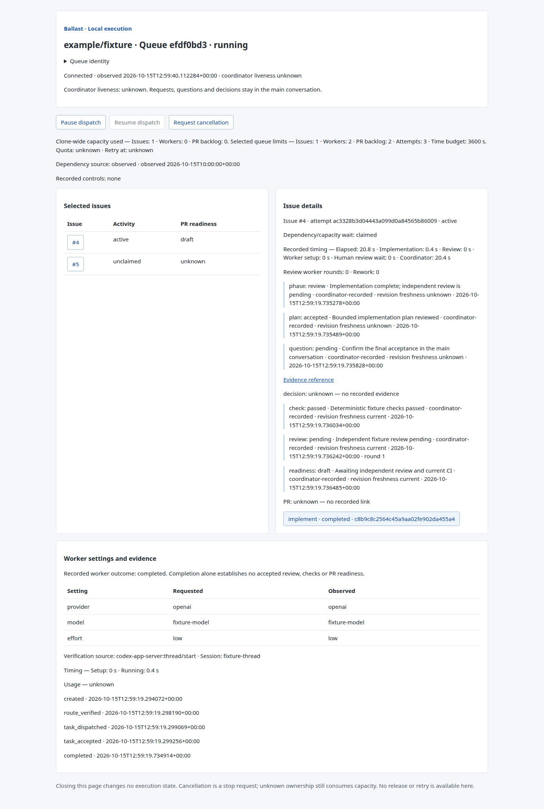
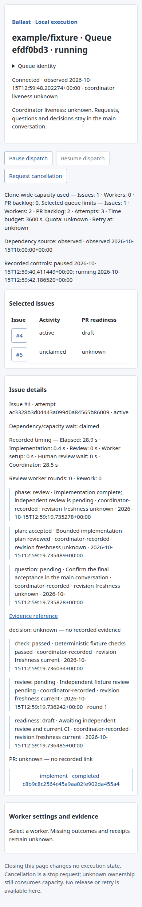
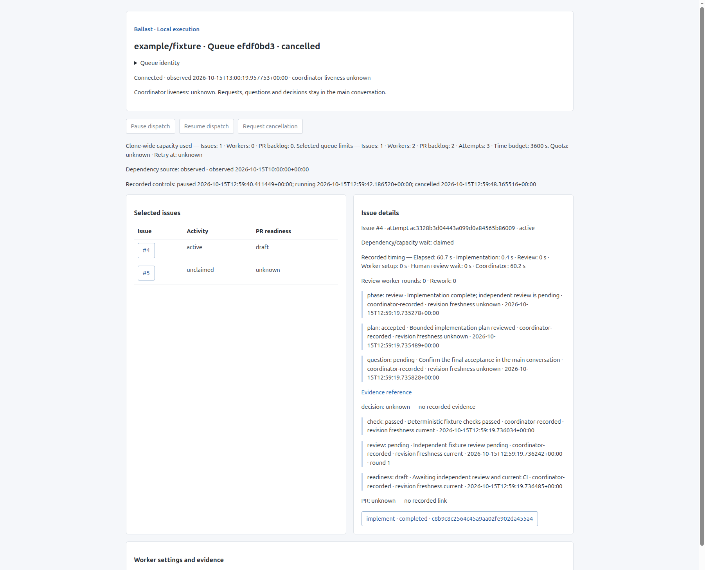
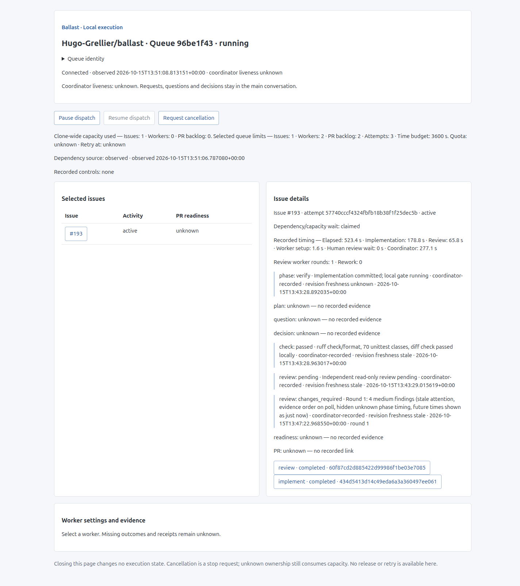
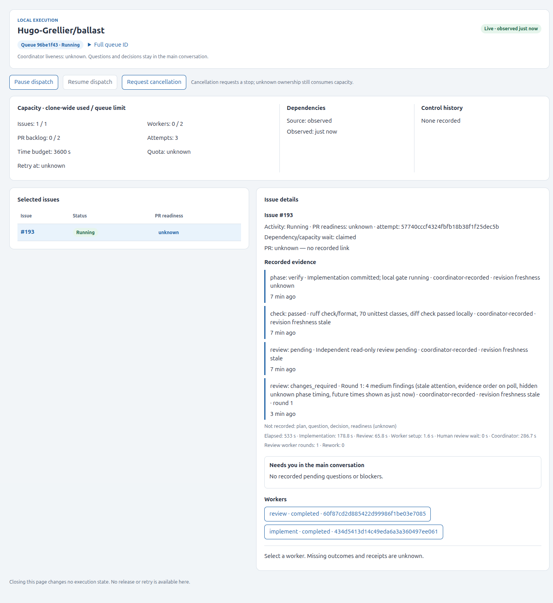
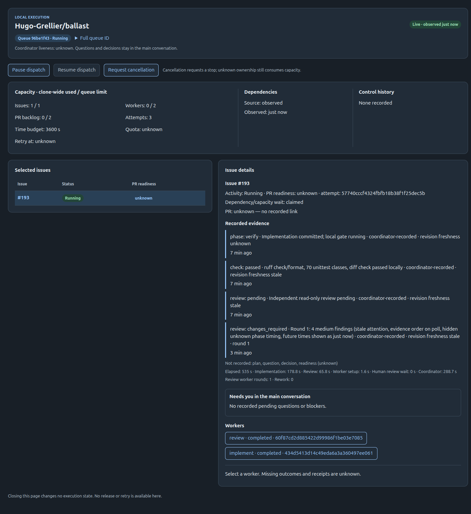
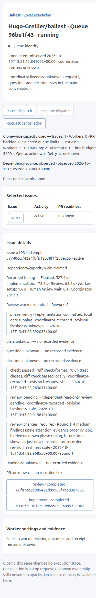
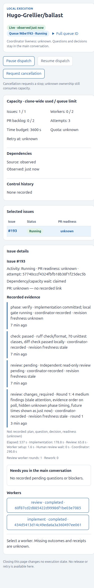
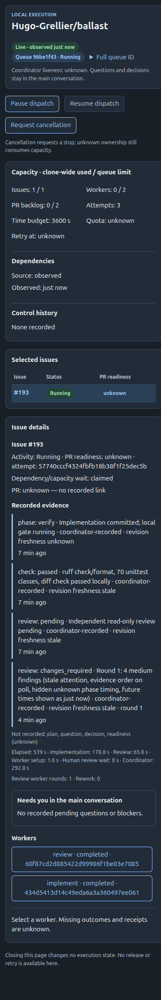

# Local execution dashboard qualification — #188

Initial qualified code and integrated base: `5add251aa79cd2fd1eaa7a35a5a4b67216223f82`, incorporating
`main` at `b60afb0c6f922260c311d3572dfc5a411766719f` (2.0.0). This record describes
local deterministic/browser evidence, not a new live model-to-GitHub delivery run.

## Checks

- `uv run --locked ruff check` — passed.
- `uv run --locked ruff format --check` — passed, 480 files.
- `uv run --locked python tests/parallel.py tests/test_*.py` — **70 passed,
  zero skipped**, four classes, including real loopback HTTP tests and native
  JavaScript behavior checks.
- `git diff --check` — passed before publication.

The tests use fictional temporary Git repositories and scripted Codex/hosting
responses. CI executes no agents or Orca. Coverage includes explicit context and
replacement, ownership, safe selected-claim/attempt joins, private-field omission,
unknown/missing records, typed progress and revision staleness, Host/Origin/session/
CSRF/body limits, fixed routes, session isolation, malformed cookies, pause/resume,
terminal cancellation, and reconnect without dispatch or evidence loss.

## Ordinary browser and standalone integration

An operator-session script created a fictional selected queue through the existing
admission backend, prepared a real temporary Git worktree, and ran the existing
scripted native worker transport. It recorded public phase/plan/question/check/
review/readiness evidence, then served the actual dashboard over loopback HTTP.
Worker execution was **scripted**, not a real model turn. No hosted issue, PR or
CI result was invented. Unchanged live worker execution remains separately
qualified in `standalone.md` and `queue.md` in this evidence directory.

Cached Playwright 1.64.0-alpha and Chromium exercised the ordinary-browser path
without Orca. The Browser plugin was unavailable; no dependency was added.
Desktop viewport 1440×1100 and mobile 390×844:

- Correct page identity, meaningful issue and worker views, requested/observed
  settings, evidence references, draft readiness and explicit unknowns.
- Pause dispatch, observe paused, resume and observe running.
- Simulated offline transport, stale label and disabled controls. Selecting an
  issue while disconnected preserves the stale label; the original defect was
  repaired and has a native JavaScript regression check.
- Reconnect and refresh preserve the same attempt/worker observations; no launch
  or duplicate writer is created.
- Browser confirmation followed by cancellation; pause/resume/cancel disabled
  after terminal cancellation. Completed worker stays completed, and review/CI/
  PR readiness remain separate.
- No uncaught page JavaScript errors, no horizontal overflow at either viewport.
  Screenshots were visually inspected for layout, readable metrics, wrapping,
  controls, settings comparison and unknown evidence.

A separate real CLI check used a fresh fictional repository and invoked
`python3 -I -S tools/dashboard.py` with explicit creation inputs. It verified the
returned capability URL, session exchange and authenticated snapshot, stopped
the foreground server, then invoked observation against the **same queue id**.
The selected issue remained unclaimed and coordinator liveness unknown; neither
startup nor reopening dispatched a worker. Hosting credentials were absent;
dependency availability stayed unknown. Temporary records were kept isolated.

## Optional Orca presentation

The same returned URL opened through Orca CLI in an explicitly selected issue
worktree, with no reliance on the focused window. Its embedded-browser snapshot
showed the same selected fictional queue, cancelled mode, retained completed
worker and disabled controls. The console contained no messages. Orca did not
launch, route, supervise or release a worker. This qualifies display only.

## Review and limits

Independent plan review round 2 approved `f47eb5f` on OpenAI `gpt-6-astra` /
`medium`; requested and observed settings matched before task input. It resolved
atomic control authority, typed progress source, scoped projection, sanitization
and deterministic UI/integration evidence findings. Final implementation review
is recorded in the PR against its exact submitted head.

Known limits: foreground service, eight bounded browser sessions, cooperative
same-user backend, Git-common clone ownership only, coordinator liveness unknown,
explicit coordinator-produced progress, and no browser answer/release/retry API.
No new live quota, actual model cancellation or hosting end-to-end run is claimed
for this UI; those unchanged backend paths have separate existing qualification.
Independent implementation round 1 requested two corrections: preserve dotted
backend route names and confirmed worker cancellation. Both were fixed with
projection/scripted cancellation regressions. A native timeout test additionally
proves helper process-group cleanup. The repaired tree passed the full 70-test
gate and a repeated ordinary-browser/CLI qualification; no browser page errors or
overflow were reported. Final exact-head review and CI are linked from the PR.
Human merge/release approval remains required.

## Screenshots

Fictional fixture data only; no capability, credentials or local destinations.

## UI/UX rework — #193

Presentation-only change to `tools/dashboard_assets/`; server routes, session,
CSRF, CSP, controls and snapshot fields are unchanged. Screenshots show the
real Ballast queue for #193 served over loopback (Playwright Chromium, no page
errors, no horizontal overflow at 1440×1100 and 390×844). The previous UI has no
dark theme, so its dark captures were identical and are omitted.

| Before | After (light) | After (dark) |
| --- | --- | --- |
|  |  |  |
|  |  |  |

Keyboard focus on the selected issue button survived several 2-second polls in
the browser; native checks in `tests/dashboard_ui.cjs` cover node identity and
order across polls, collapsed absent evidence, attention clearing after a later
declaration, labelled missing phase timing and future relative times.
